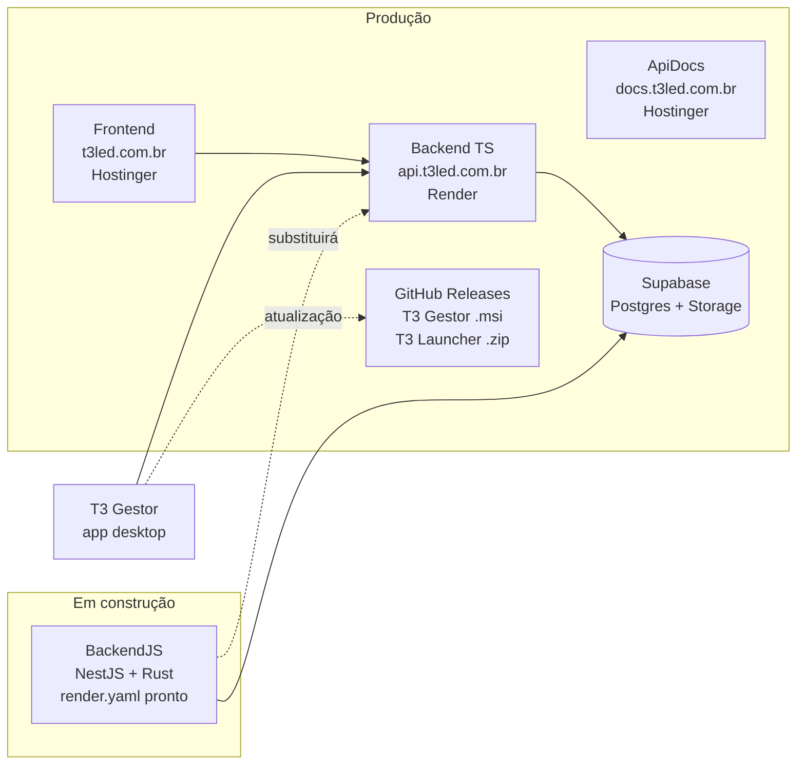
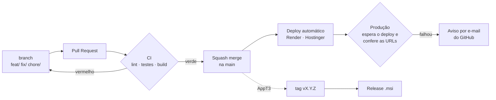

# Mapa da T3 OOH

O que já existe, onde roda, o que falta e como o código chega à produção. Atualizado em 2026-11-05.
Trabalho em andamento, pendências e regras para o Claude continuar em qualquer computador: [CONTEXTO.md](CONTEXTO.md).

## Visão geral

## Repositórios

| Repositório | Estado | Commits | Publicação | CI |
| --- | --- | --- | --- | --- |
| [Frontend](https://github.com/T3OOH/Frontend) | Em produção | 69 desde 2026-07-13 | Hostinger, deploy da `main` | lint, typecheck, build |
| [Backend](https://github.com/T3OOH/Backend) | Em produção | 44 desde 2026-07-13 | Render (`t3-led-ooh-plataforma`), deploy da `main` | typecheck, build |
| [BackendJS](https://github.com/T3OOH/BackendJS) | Migração quase completa, não publicado | 17 desde 2026-10-31 | Render via `render.yaml` (falta criar o serviço) | lint, 236 testes, e2e, build + Rust fmt/clippy/test |
| [AppT3](https://github.com/T3OOH/AppT3) | Em uso pela equipe (v1.3.0) | 37 desde 2026-11-03 | Releases no GitHub | `mvn verify`, ruff, pytest, pacote Windows |
| [ApiDocs](https://github.com/T3OOH/ApiDocs) | Em produção (público, `noindex`) | 5 desde 2026-11-04 | Hostinger, deploy da `main` | conferência das 89 rotas |
| [Ambiente](https://github.com/T3OOH/Ambiente) | Pronto | — | — | `docker compose config`, shellcheck |
| [.github](https://github.com/T3OOH/.github) | Padrões da organização | — | — | — |

## O que já foi feito

### Plataforma (Frontend + Backend)
- **Site público**: tela de escolha T3 OOH × T3 Solution, catálogo, mapa interativo (celular incluso), página da T3 Solution com vídeo, SEO para Google e IAs, cabeçalhos de segurança.
- **Contas**: login com e-mail (reCAPTCHA) e Google, sessões por aparelho, alerta de acesso novo, recuperação de senha, perfil com preferências visuais.
- **Pedidos**: orçamento do cliente em etapas, cupons, pedido da T3 Solution com protocolo e e-mail, tempo de reprodução dos painéis.
- **CRM**: fila de leads com claim atômico, funil (contato → negociação → proposta → pós-venda), linhas T3 OOH e T3 Solution, propostas em PDF, clientes do site no seletor.
- **Gestão**: relatórios (vendas, funil, previsão, ocupação), tráfego e origem dos leads, auditoria, busca rápida (Ctrl+K), usuários e caixas `@t3led.com.br` pela API da Hostinger.
- **Equipe**: reuniões com WebRTC e chat (tela estilo Discord), agenda, chat em tempo real.
- **Infra**: domínio `t3led.com.br`, API em `api.t3led.com.br`, e-mails de `nao-responda@t3led.com.br`, teste de carga com 1000 usuários, keepalive do Render, respostas de erro padronizadas em pt-BR.

### App desktop (AppT3)
- **T3 Gestor** 1.1 → 1.3: login pelo site, sessão criptografada, CRM em quadro, catálogo, usuários, auditoria, chat, agenda, reuniões, relatórios em Excel/PDF (serviço Python embutido), bandeja do Windows, aba de e-mails.
- **T3 Launcher**: estilo Steam/Riot, atualização sozinho em segundo plano, download com senha pelo site.
- Auditoria de telas (sem texto cortado nem barra de rolagem em 1100×700, 1366×728 e 1920×1040).

### Backend novo (BackendJS)
- 74 rotas migradas para NestJS em JavaScript, serviço de eventos em Rust, 236 testes unitários + e2e.

## O que falta

| Prioridade | Item | Repositório |
| --- | --- | --- |
| Alta | Paridade com o Backend: **reuniões** (rotas e sinalização WebRTC) e **download do Launcher com senha / auto-atualização** ainda não existem no BackendJS | BackendJS |
| Alta | Criar o serviço no Render pelo `render.yaml`, virar o site e o app para a API nova e mudar o keepalive | BackendJS, Frontend, AppT3 |
| Média | Testes automatizados no Backend TS e no Frontend (hoje o CI só faz typecheck, lint e build) | Backend, Frontend |
| Média | Release do app pelo CI (hoje o `.msi` é gerado no PC com WiX e publicado à mão) | AppT3 |
| Média | Mesclar os PRs do Dependabot pendentes (Backend 12, Frontend 8, BackendJS 3), incluindo `actions/checkout` e `setup-node` v7 | todos |
| Baixa | Proteger `docs.t3led.com.br` com senha (decisão pendente) e remover o `vercel.json` antigo | ApiDocs |
| Baixa | Desligar o `t3ooh.com` na Vercel depois da migração | Frontend |
| Baixa | Apagar branches antigas já mescladas (repositórios privados não apagavam a branch no merge) | todos |
| Baixa | Proteção da `main` nos privados exige GitHub Pro/Team (hoje só os públicos têm) | BackendJS, AppT3, ApiDocs, Ambiente |

## Pipeline

| Etapa | Onde | Quem faz |
| --- | --- | --- |
| CI | `.github/workflows/ci.yml` de cada repositório | GitHub Actions, em todo PR e push na `main` |
| Merge | GitHub, só *squash*, branch apagada | Responsável (ou automático com CI verde) |
| Deploy | Render (Backend), Hostinger (Frontend, ApiDocs) | Automático ao mudar a `main` |
| Produção | `.github/workflows/producao.yml` → [workflow reutilizável](.github/workflows/verificar-producao.yml) | GitHub Actions. No Backend espera o `/health` responder o commit novo (`RENDER_GIT_COMMIT`) |
| Keepalive | `Backend/.github/workflows/keepalive.yml` | A cada 10 min |
| Dependências | Dependabot (npm, Maven, pip, Docker, Actions) | Segunda-feira; Actions mensal |
| Issues | `atribuir-issues.yml` | Atribui ao responsável (`RESPONSAVEL_ISSUES`) |

## Padrão dos repositórios

| Item | Frontend | Backend | BackendJS | AppT3 | ApiDocs | Ambiente |
| --- | --- | --- | --- | --- | --- | --- |
| `.editorconfig` / `.gitattributes` comuns | ✓ | ✓ | ✓ | ✓ | ✓ | ✓ |
| `CODEOWNERS` | ✓ | ✓ | ✓ | ✓ | ✓ | ✓ |
| Dependabot | ✓ | ✓ | ✓ | ✓ | ✓ | ✓ |
| CI com `concurrency` | ✓ | ✓ | ✓ | ✓ | ✓ | ✓ |
| Workflow `Produção` | ✓ | ✓ | — | — | ✓ | — |
| `atribuir-issues` | ✓ | ✓ | ✓ | ✓ | ✓ | ✓ |
| Só squash + apagar branch | ✓ | ✓ | ✓ | ✓ | ✓ | ✓ |

Nomes de branch, commits e PRs: ver [CONTRIBUTING.md](CONTRIBUTING.md).
