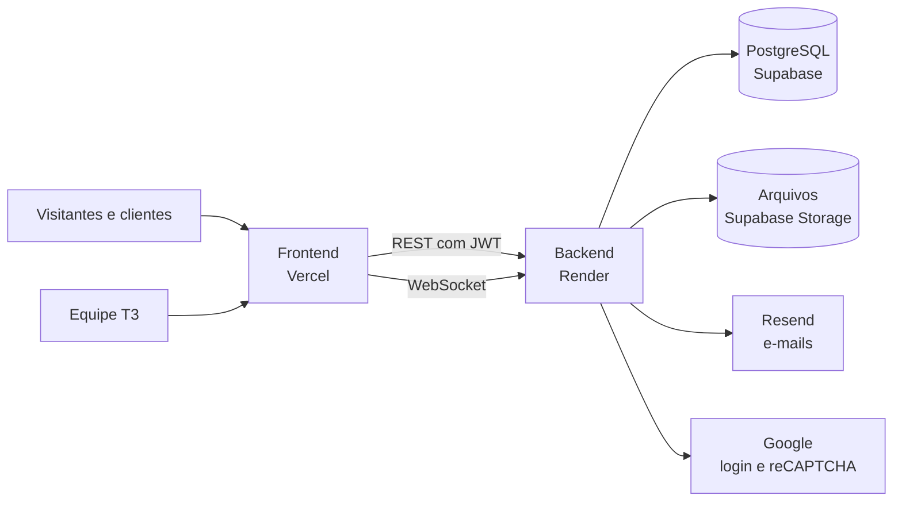
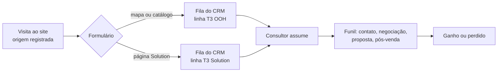

# T3 OOH

Painéis de LED e mídia exterior em Goiânia e no interior de Goiás.

[t3ooh.com](https://t3ooh.com) · [Frontend](https://github.com/T3OOH/Frontend) · [Backend](https://github.com/T3OOH/Backend)

---

A T3 tem duas linhas de negócio, e a plataforma atende as duas:

- **T3 OOH**: aluguel de espaço publicitário nos telões de LED da rede. O anunciante escolhe os pontos no mapa ou no catálogo, define o prazo e recebe o orçamento.
- **T3 Solution**: venda, instalação e suporte de painéis de LED sob medida para casas, condomínios, empresas, comércio e empreendimentos.

Os pedidos das duas linhas caem no mesmo CRM, separados por linha, e a equipe acompanha tudo do primeiro contato até o pós-venda.

## O que tem na plataforma

### Site público

- Tela de entrada para escolher entre T3 OOH e T3 Solution, cada lado com o próprio vídeo.
- Mapa de painéis com filtros por estado e cidade, detalhes de cada ponto e carrinho de orçamento.
- Catálogo com os mesmos painéis em lista, para montar pacotes.
- Página da T3 Solution com formulário de orçamento que abre um negócio no CRM.
- Desconto por prazo calculado no servidor: 15% em 3 meses, 20% em 6 e 30% a partir de 12.
- Páginas públicas pré-renderizadas no build, com dados estruturados (schema.org), `sitemap.xml`, `robots.txt` e `llms.txt`, para buscadores e assistentes de IA lerem o conteúdo sem executar JavaScript.

### Conta do cliente e da equipe

- Cadastro e login com e-mail e senha ou com o Google.
- Sessão mantida por aparelho, com aviso por e-mail quando a conta entra em um aparelho novo e o botão "Não fui eu" para desconectar tudo e trocar a senha.
- Perfil para todos os papéis: dados, orçamentos (clientes), aparência do site e segurança (aparelhos conectados, troca de senha, atividade recente).

### Gestão (administradores e gestores)

- Painéis: cadastro, fotos, preço, situação e posição no mapa.
- Pedidos do catálogo, usuários e papéis, portfólio da T3 Solution e página Sobre.
- Tráfego e leads: visitas por dia, origem de cada visita e de cada lead (Google, Instagram, assistentes de IA, campanhas), páginas mais vistas, exportação em CSV e gerador de links de campanha.

### CRM comercial

- Fila de atendimento com os pedidos do site que ainda não têm consultor.
- Funil em colunas, filtrado por linha de negócio, com etapas, ganhos e perdidos.
- Negócios da T3 Solution com o projeto: aplicação, ambiente, medidas, pixel pitch, serviços e valor.
- Clientes, propostas em PDF, agenda, cupons de desconto e chat em tempo real.

## Repositórios

| Repositório | Tecnologias | Hospedagem |
| --- | --- | --- |
| [Frontend](https://github.com/T3OOH/Frontend) | React 19, Vite, TypeScript, Tailwind CSS, Framer Motion, Leaflet | Vercel |
| [Backend](https://github.com/T3OOH/Backend) | Node.js, Express 5, Prisma 7, Socket.IO, Zod | Render |

Banco de dados PostgreSQL e armazenamento de arquivos no Supabase. E-mails pelo Resend, no domínio `t3ooh.com`.

## Arquitetura

O caminho de um lead, do site ao fechamento:

## Papéis de acesso

| Papel | Pode acessar |
| --- | --- |
| Administrador | Tudo, incluindo usuários e papéis |
| Gestor | Gestão (painéis, pedidos, tráfego, conteúdo) e todo o CRM |
| Comercial | CRM, restrito aos próprios clientes e negócios |
| Cliente e empresa | Área do cliente e orçamentos |

## Segurança

- Token de acesso de 15 minutos e refresh token por aparelho, trocado a cada uso. O banco guarda só o hash.
- Limite de tentativas por IP e por conta, reCAPTCHA no login e no cadastro.
- Row Level Security ligado em todas as tabelas do Supabase.
- Estatísticas de visita próprias e anônimas, sem guardar IP, e opção "Só o essencial" no aviso de privacidade.

A arquitetura de sessões, os e-mails de alerta e o roteiro de resposta a incidentes estão em [`Backend/docs/SEGURANCA.md`](https://github.com/T3OOH/Backend/blob/main/docs/SEGURANCA.md). Para reportar uma vulnerabilidade, veja a [política de segurança](https://github.com/T3OOH/.github/blob/main/SECURITY.md).

## Como contribuir

1. Crie uma branch a partir da `main` atualizada (`feat/...`, `fix/...`, `docs/...`).
2. Siga o README de cada repositório para rodar localmente.
3. Abra um Pull Request explicando o que mudou e como testar. O CI precisa passar.
4. Mudanças no banco entram como migração do Prisma e são aplicadas antes do deploy do backend.
5. Nunca faça commit de `.env`, chaves ou senhas.

O guia completo está em [CONTRIBUTING.md](https://github.com/T3OOH/.github/blob/main/CONTRIBUTING.md).

---

T3 LED Mídia e Tecnologia · CNPJ 43.773.494/0001-50 · Goiânia, GO

