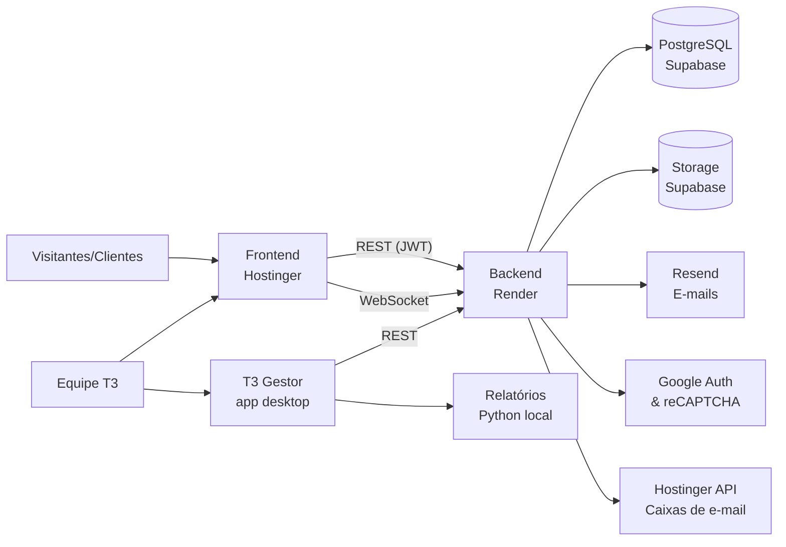

<div align="center">
  
  

  # T3 LED & T3 SOLUTION
  
  *Inovação em painéis de LED e mídia exterior em Goiânia e interior de Goiás.*

  [](https://t3led.com.br)
  [](https://github.com/T3OOH/Frontend)
  [](https://github.com/T3OOH/Backend)

  ---
</div>

A **T3** opera em duas frentes de negócio potentes, totalmente integradas em nossa plataforma unificada. Do primeiro clique no mapa ao pós-venda no CRM, nossa tecnologia garante uma experiência fluida para anunciantes e para o nosso time.

> **T3 OOH:** Aluguel de espaço publicitário nos telões de LED da nossa rede. O anunciante navega, escolhe os pontos e recebe orçamentos automatizados.
> 
> **T3 Solution:** Venda, instalação e suporte de painéis de LED sob medida para casas, condomínios, empresas e empreendimentos.

---

## O que rola na plataforma?

<details>
<summary><b>Site Público (A vitrine)</b></summary>

- **Dual Experience:** Tela de entrada interativa para escolher entre T3 OOH e T3 Solution, com vídeos imersivos para cada lado.
- **Mapa e Catálogo Inteligentes:** Navegue por filtros (estado/cidade), veja detalhes precisos de cada telão e adicione ao "carrinho de orçamentos". Layout ultra responsivo com atalhos nativos para mobile.
- **Motor de Preços:** Descontos progressivos calculados no servidor (15% em 3 meses, 20% em 6 e 30% a partir de 12).
- **SEO Ready:** Páginas pré-renderizadas no build (SSG), dados estruturados (schema.org), `sitemap.xml`, `robots.txt` e `llms.txt` para máxima visibilidade orgânica e IA.
</details>

<details>
<summary><b>Portal do Cliente e Equipe</b></summary>

- **Acesso Descomplicado:** Login via E-mail/Senha ou Google Auth.
- **Segurança de Sessão:** Controle por dispositivo. Alertas de "novo acesso" por e-mail com botão de emergência "Não fui eu" para derrubar sessões e exigir troca de senha.
- **Dashboard Personalizado:** Gestão de orçamentos, etapas da negociação, histórico de atividades e configurações de aparência.
- **Suporte 1-Click:** Botão "Acionar suporte" que abre o WhatsApp da nossa equipe já com contexto do erro e código de rastreio.
</details>

<details>
<summary><b>CRM Comercial Integrado</b></summary>

- **Fila Inteligente:** Captação de leads direto do site para atendimento.
- **Gestão Visual:** Funil Kanban por linha de negócio (OOH e Solution), mapeando de contato a pós-venda.
- **Projetos Detalhados (Solution):** Controle de aplicação, medidas, pixel pitch e serviços atrelados.
- **Ferramentas do Consultor:** Geração de propostas em PDF, agenda integrada, cupons de desconto e chat em tempo real.
</details>

<details>
<summary><b>Painel de Gestão (Admins)</b></summary>

- **Controle Total:** Cadastro de painéis, fotos, precificação e geolocalização.
- **Analytics & Tráfego:** Métricas de visitas, origem de leads, exportação CSV e gerador de links parametrizados.
- **Inteligência de Negócios:** Previsão de receita, funil de conversão, ocupação de painéis e histórico financeiro (12 meses).
- **Auditoria Rigorosa:** Registro de quem fez o que (com diff de antes/depois), cobrindo ações na interface e direto no banco.
- **Omni-Search:** Busca global (`Ctrl+K` / `Cmd+K`) por todo o painel interno.
</details>

---

## Nossos Repositórios

| Repositório | Propósito | Stack Tecnológico | Onde Roda |
| :--- | :--- | :--- | :--- |
| **[Frontend](https://github.com/T3OOH/Frontend)** | Site público, mapa, portal, gestão e CRM. | React 19, Vite, TypeScript, Tailwind | Hostinger (`t3led.com.br`) |
| **[Backend](https://github.com/T3OOH/Backend)** | API REST e WebSocket (Produção). | Node.js, Express 5, Prisma 7, Socket.IO, Zod | Render (`api.t3led.com.br`) |
| **[BackendJS](https://github.com/T3OOH/BackendJS)** | Nova API (Futuro) + Serviço de eventos. | NestJS (JS), Prisma, Rust | Render *(Em breve)* |
| **[AppT3](https://github.com/T3OOH/AppT3)** | Apps desktop (Gestor, Launcher) e Relatórios. | Java 25, JavaFX, Python (FastAPI) | GitHub Releases (`.msi`) |
| **[ApiDocs](https://github.com/T3OOH/ApiDocs)** | Documentação da nossa API. | HTML, CSS e JS (Vanilla) | Hostinger (`docs.t3led.com.br`) |
| **[Ambiente](https://github.com/T3OOH/Ambiente)** | Setup de desenvolvimento local. | Docker Compose | Localhost |

> **Infraestrutura Extra:** Postgres + Storage no **Supabase** | E-mails transacionais via **Resend** (`nao-responda@t3led.com.br`).
> *Acompanhe nosso roadmap e processos de deploy no arquivo [MAPA.md](https://github.com/T3OOH/.github/blob/main/MAPA.md).*

---

## Fluxos e Arquitetura

### Ecossistema T3


## A Jornada do Lead
```flowchart LR
    S[Visita ao Site<br/>Origem Rastreada] --> F{Lead}
    F -- Mapa/Catálogo --> Q[Fila CRM<br/>T3 OOH]
    F -- Orçamento Solution --> QS[Fila CRM<br/>T3 Solution]
    Q --> C[Consultor Assume]
    QS --> C
    C --> P[Funil Comercial:<br/>Contato ➔ Proposta ➔ Pós-Venda]
    P --> G((Ganho / Perdido)) 
```
