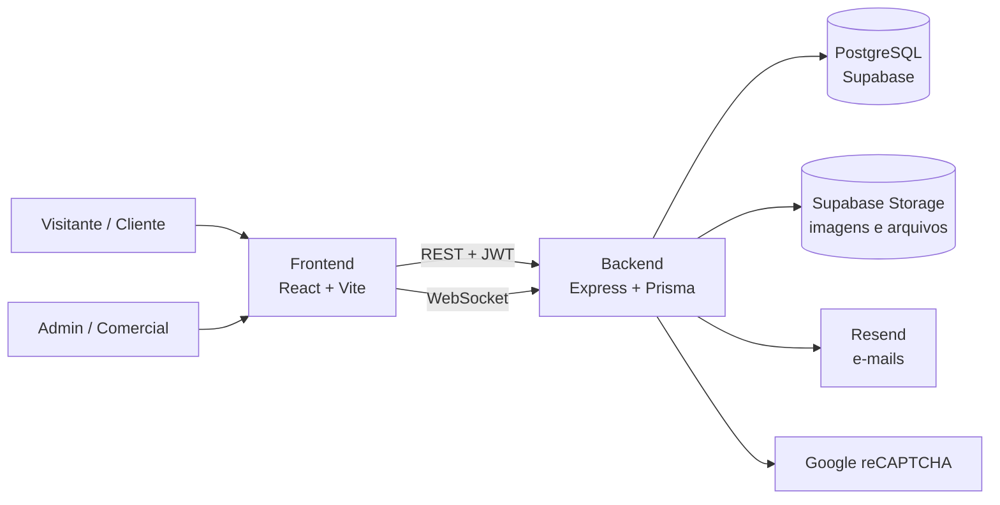

# T3 OOH

**Plataforma de mídia Out-of-Home (OOH/DOOH) — encontre, monte e contrate campanhas em painéis de LED.**

[Site](https://t3ooh.com) · [Frontend](https://github.com/T3OOH/Frontend) · [Backend](https://github.com/T3OOH/Backend)

---

## Sobre a plataforma

A **Plataforma T3 OOH** conecta anunciantes aos painéis de LED e mídia exterior da T3. Ela reúne, em um só lugar:

| Módulo | O que faz |
| --- | --- |
| **Site institucional** | Home, serviços, T3 Solution, sobre e contato. |
| **Mapa interativo** | Painéis geolocalizados com filtros, detalhes e carrinho de orçamento. |
| **Checkout de orçamento** | O cliente escolhe painéis e duração da campanha; a solicitação vira um negócio no CRM. |
| **Área do cliente** | Perfil e acompanhamento dos orçamentos enviados. |
| **Dashboard administrativo** | Cadastro de painéis, usuários e permissões, pedidos, banners, portfólio e conteúdo institucional. |
| **CRM comercial** | Pipeline (kanban), clientes, propostas em PDF, chat em tempo real, agenda e cupons de desconto. |

## Repositórios

| Repositório | Stack | Descrição |
| --- | --- | --- |
| [**Frontend**](https://github.com/T3OOH/Frontend) | React 19 · Vite · TypeScript · Tailwind CSS · Leaflet | Site público, mapa, dashboard e CRM. Deploy na Vercel. |
| [**Backend**](https://github.com/T3OOH/Backend) | Node.js · Express 5 · Prisma 7 · PostgreSQL (Supabase) · Socket.IO | API REST, autenticação JWT, upload para Supabase Storage e chat em tempo real. |

## Arquitetura

## Perfis de acesso

| Perfil | Acesso |
| --- | --- |
| `ADMIN` | Tudo: dashboard, usuários, CRM completo. |
| `MANAGER` | Gestão de painéis, conteúdo e CRM completo. |
| `COMERCIAL` | CRM restrito aos próprios clientes e negócios. |
| `COMPANY` / `USER` | Área do cliente e orçamentos. |

## Como contribuir

1. Crie uma branch a partir de `main` (`feat/…`, `fix/…`, `docs/…`).
2. Siga as instruções de execução local no README de cada repositório.
3. Abra um Pull Request descrevendo a mudança e como testá-la.
4. Nunca faça commit de arquivos `.env`, chaves ou credenciais.

---

© T3 OOH — Todos os direitos reservados.

